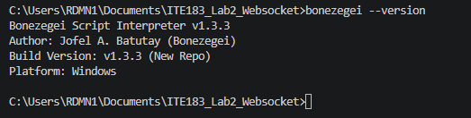
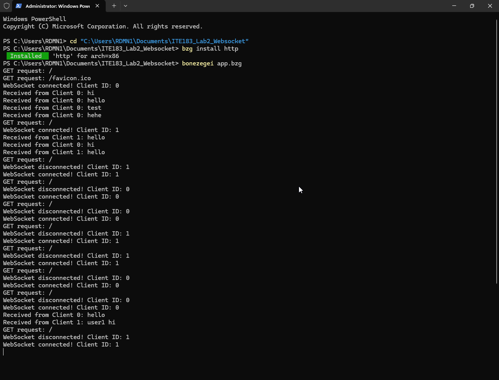
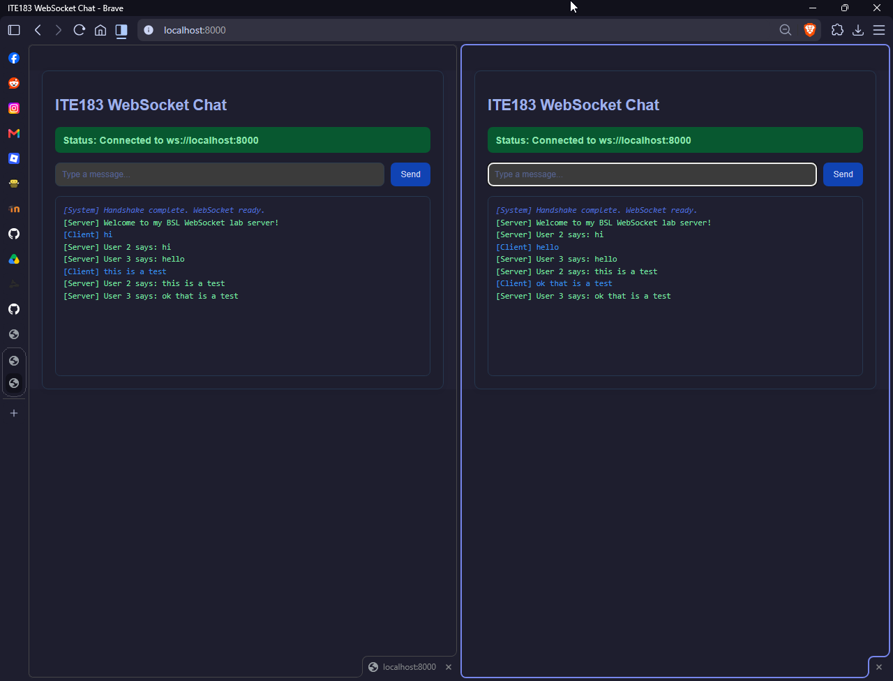
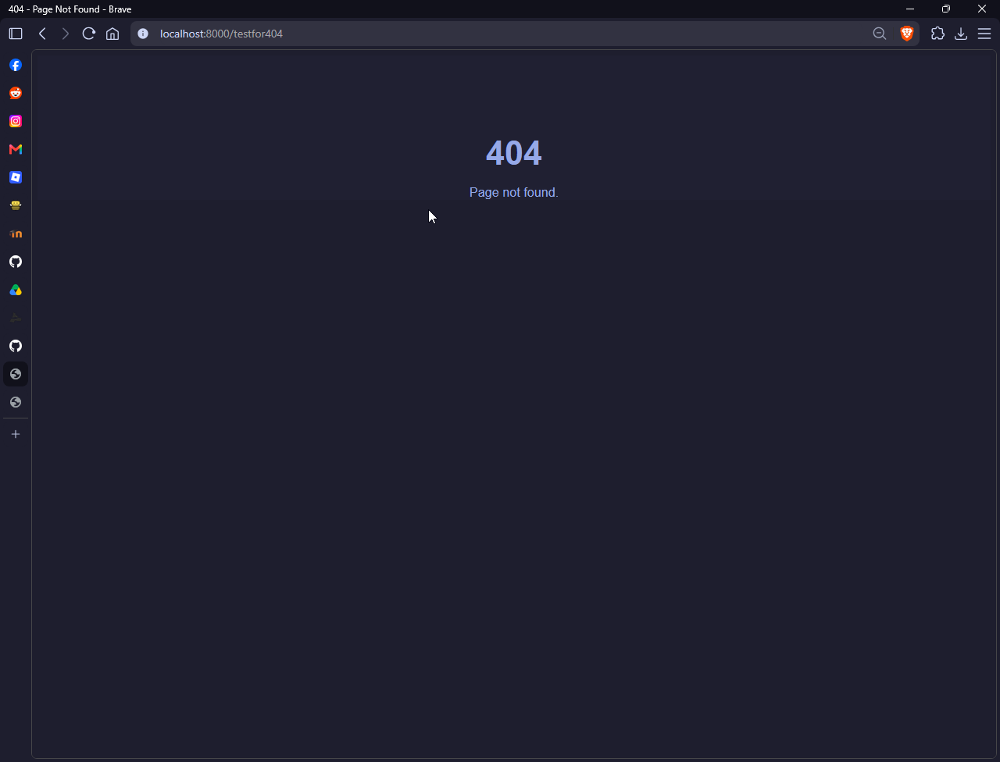

# ITE183_Lab2_Websocket

This is my own implementation of the Bonezegei WebSocket server laboratory activity.

## Features
- HTTP server that serves the client page and a custom 404 page
- WebSocket server with login-style connection handling
- Real-time message broadcasting to all connected clients

## Run
```bash
bzg install http
bonezegei app.bzg
```

Then open `http://localhost:8000/` in a browser.

## Lab Verification

### Bonezegei version


### HTTP package installation and server execution


### WebSocket chat broadcast


### Custom 404 page

